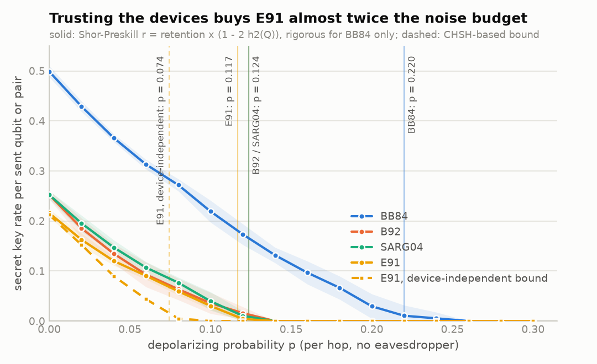
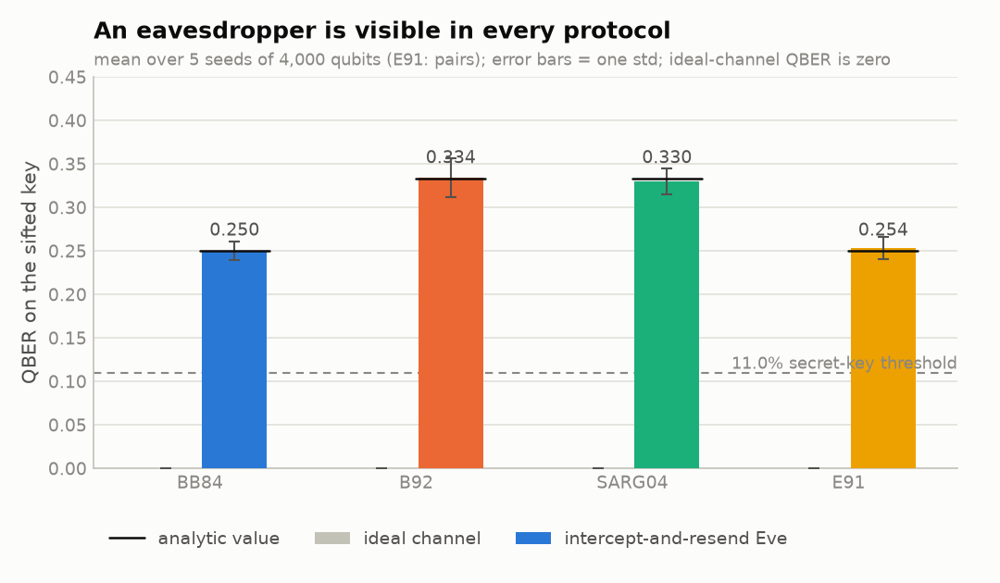
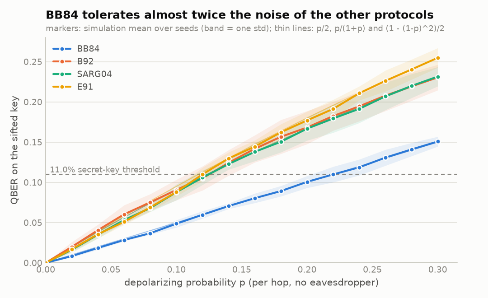
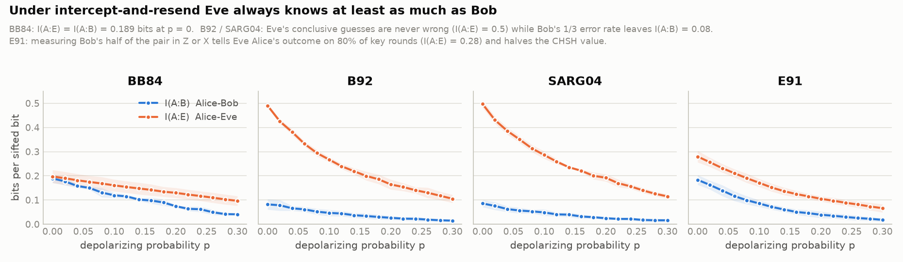
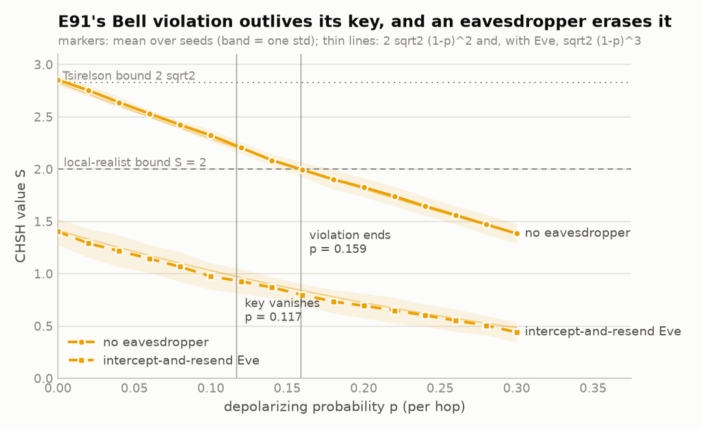

# qkd-sim

[](https://github.com/piperidesl/qkd-sim/actions/workflows/ci.yml)


[](LICENSE)

Four quantum key distribution protocols, the prepare-and-measure BB84, B92
and SARG04 and the entanglement-based E91, simulated shot by shot on Qiskit
Aer with an intercept-and-resend eavesdropper and a depolarizing channel.
Every run yields a full transcript, protocol-correct sifting, the QBER, Eve's
Shannon information about the key and a Shor-Preskill secret-key-rate
estimate; E91 adds a CHSH Bell test and the device-independent key rate it
certifies. Results are checked against closed-form theory in the test suite,
runs are reproducible from a single seed, and 20,000 qubits take well under a
second.



## Quickstart

```bash
python -m venv .venv && source .venv/bin/activate   # .venv\Scripts\activate on Windows
pip install -e ".[dev]"

qkd-sim run --protocol bb84 -n 10000 --eve --seed 42
pytest
```

```
BB84  n=10000  eve=yes  noise=0.000  seed=42
  key retention    0.4984   (theory 0.5000)
  QBER             0.2568   (theory 0.2500)
  Eve agreement    0.7408
  I(A:B)           0.1781 bits per sifted bit
  I(A:E)           0.1744 bits per sifted bit
  secret key rate  0.0000 per sent qubit   (f_ec=1.00, threshold QBER 0.1100)
  simulated in     0.28 s
```

The entanglement-based protocol reports its Bell test as well:

```
$ qkd-sim run --protocol e91 -n 10000 --seed 42
E91  n=10000  eve=no  noise=0.000  seed=42
  key retention    0.2218   (theory 0.2222)
  QBER             0.0000   (theory 0.0000)
  I(A:B)           1.0000 bits per sifted bit
  secret key rate  0.2218 per sent qubit   (f_ec=1.00, threshold QBER 0.1100)
  CHSH S           2.8081   (theory 2.8284)   (local bound 2, quantum maximum 2.8284)
  DI key rate      0.2081 per sent pair   (device-independent bound from S and QBER)
  simulated in     0.19 s
```

From Python:

```python
from qkd_sim import simulate, summarize

transcript = simulate("sarg04", 10_000, noise=0.05, seed=42)  # one row per qubit
print(summarize(transcript, protocol="sarg04"))
# Summary(protocol='sarg04', num_bits=10000, with_eve=False, retention=0.2598,
#         qber=0.0497, eve_agreement=nan, i_ab=0.7151, i_ae=0.0, key_rate=0.1118, f_ec=1.0)
```

`qkd-sim run --show 5` prints the first rounds of the transcript, and
`--csv path` writes the whole thing. `qkd-sim sweep` scans channel noise over
several seeds and writes a CSV, which is how `data/sweep.csv` and every figure
below were produced (`scripts/run_sweep.py`, then `scripts/make_figures.py`).

## Results

Simulation against theory on an ideal channel, mean over 5 seeds of 4,000
qubits each (`data/sweep.csv`):

| protocol | setting | key retention | theory | QBER | theory | Eve agreement | I(A:E) bits |
|---|---|---|---|---|---|---|---|
| BB84 | ideal channel | 0.499 | 1/2 | 0.000 | 0 | | |
| BB84 | intercept-and-resend | 0.499 | 1/2 | 0.250 | 1/4 | 0.755 | 0.197 |
| B92 | ideal channel | 0.252 | 1/4 | 0.000 | 0 | | |
| B92 | intercept-and-resend | 0.372 | 3/8 | 0.334 | 1/3 | 0.491 | 0.491 |
| SARG04 | ideal channel | 0.252 | 1/4 | 0.000 | 0 | | |
| SARG04 | intercept-and-resend | 0.371 | 3/8 | 0.330 | 1/3 | 0.497 | 0.497 |
| E91 | ideal channel | 0.216 | 2/9 | 0.000 | 0 | | |
| E91 | intercept-and-resend | 0.216 | 2/9 | 0.254 | 1/4 | 0.800 | 0.280 |

E91's CHSH value comes out at 2.85 on the ideal channel (theory `2 sqrt2 =
2.83`) and 1.40 under attack (theory `sqrt2 = 1.41`).



**Channel noise without an attacker.** Under a depolarizing channel of
strength `p` the QBER grows as `p/2` for BB84 but as `p/(1+p)` for B92 and
SARG04, whose unambiguous-discrimination sifting turns noise into
conclusive-but-wrong rounds, and as `(1 - (1-p)^2)/2` for E91, both of whose
qubits travel through the channel. BB84 crosses the 11% key-rate threshold at
`p = 0.22`; the other three at `p = 0.12`.



**What the eavesdropper learns.** On BB84 an intercept-and-resend attack
leaves Eve with exactly as much information about the sifted key as Bob has,
`I(A:E) = I(A:B) = 1 - h2(1/4) = 0.189` bits, which is the operational
meaning of the 25% QBER signature. On B92 and SARG04 she does far better:
her conclusive guesses on a clean state are never wrong, so she holds 0.5 bits
per sifted bit while Bob's 1/3 error rate leaves him 0.08. On E91 she measures
Bob's half of the pair in Z or X, learns Alice's outcome on 80% of the key
rounds (0.28 bits against Bob's 0.19) and, in doing so, halves the CHSH value.



**The Bell test.** E91's CHSH value falls as `2 sqrt2 (1-p)^2` under channel
noise and only reaches the local-realist bound `S = 2` at `p = 0.16`, after the
heuristic key has vanished at `p = 0.12` and well after the device-independent
key at `p = 0.07`. An intercept-and-resend attacker does not need noise to be
caught: she halves `S` to `sqrt2` at once.



## What is inside

```
src/qkd_sim/
    primitives.py   the four states, two bases, prepare / measure circuits, Aer execution
    channel.py      depolarizing noise model for the quantum channel
    engine.py       Alice -> (Eve) -> Bob transmission in two batched simulator passes
    transcript.py   the per-round DataFrame schema and its validator
    bb84.py         BB84: basis reconciliation
    b92.py          B92: unambiguous state discrimination
    sarg04.py       SARG04: bit in the basis, public announcement of a non-orthogonal pair
    e91.py          E91: Bell-pair source, three settings per party, CHSH test
    metrics.py      retention, QBER, Eve agreement, mutual information, CHSH, summary
    keyrate.py      binary entropy, Shor-Preskill key rate, device-independent rate, threshold
    theory.py       closed-form expectations used by the tests and the figures
    cli.py          the qkd-sim command
tests/              95 tests, about 5 s
scripts/            run_sweep.py, make_figures.py, benchmark.py
docs/theory.md      derivations of every number above
```

Every protocol returns the same transcript: one row per qubit (or pair) with
Alice's basis, key bit and state, Eve's basis, outcome and guess when present,
Bob's basis, outcome and state, whether the round survived sifting, and Bob's
key bit. The metrics are plain reductions over those columns, so they are
shared by all four protocols and can be run on a transcript loaded back from
CSV. E91's basis columns hold its measurement angles and it adds a
`round_use` column (`key`, `chsh` or `discard`) from which the CHSH value is
computed.

## Design notes

**Execution cost is independent of the number of qubits.** Every round of
every protocol is one of at most eight circuits: four states times two
measurement bases. The engine groups rounds by that triple and runs each
distinct circuit once with as many shots as it needs, reading per-shot memory
back into the transcript. Eve's re-sent state depends on her outcome, so an
attacked run is two such passes. Compared with building, transpiling and
submitting one circuit per qubit (`scripts/benchmark.py`):

| strategy | qubits | seconds |
|---|---|---|
| one transpile + run per qubit | 200 | 29.8 |
| grouped engine, with Eve | 200 | 0.04 |
| grouped engine, with Eve | 20,000 | 0.46 |

**One seed reproduces everything.** The user's seed feeds a numpy
`Generator` that draws all classical choices and a fresh `seed_simulator`
for each Aer pass. The two passes must not share a seed, or shot `i` of Eve's
measurement and shot `i` of Bob's would consume correlated random streams;
`tests/test_engine.py` checks that they differ.

**The channel is attached to an identity gate.** The state `|0>` is prepared
with no gates, so a noise model on the `x` and `h` gates would let a quarter
of all transmissions through untouched. Every prepared circuit ends in an
`id` that the depolarizing error is attached to instead, giving exactly one
noise event per hop and making the analytic QBER formulas hold exactly.

**SARG04 encodes the bit in the basis, and it matters.** An earlier version
of this simulator took the bit to be the index of the state within its basis.
With that convention half of Bob's wrong deductions still land on the correct
bit by luck, and the QBER under attack reads 1/6 instead of 1/3, so the
protocol looks twice as secure as it is. `tests/test_sarg04.py` computes
both conventions on the same transcript as a regression test.

**B92 sifting cannot see Alice's bit.** The sifting function takes only
Bob's bases and outcomes; a test asserts that its signature has no Alice
argument and that shuffling Alice's bits leaves the sifted key unchanged.

**The key-rate bound is a theorem for BB84 only.** `r = retention x
max(0, 1 - (1 + f_ec) h2(Q))` is the Shor-Preskill asymptotic rate with an
error-correction inefficiency `f_ec`. It is applied to B92, SARG04 and E91
for a like-for-like comparison and labelled heuristic wherever it appears.

**E91 is the same engine with two-qubit circuits.** A round is one of nine
(Alice setting, Bob setting) pairs, so an unattacked run is nine circuits of a
Bell pair measured along two angles; with Eve it is six two-qubit circuits for
the Alice-Eve stage plus twelve single-qubit ones for the eigenstate she
re-sends to Bob. Eve measures Bob's half of the pair only, and that is enough:
on |Phi+> her measurement projects Alice's qubit onto the same eigenstate, the
pair becomes a product state, every correlator halves and S drops from
2 sqrt2 to sqrt2. The error she causes on the key rounds is 25%, BB84's
signature exactly.

**E91's key rate is reported twice.** Its two key settings, pi/4 and pi/2,
are not conjugate bases (their eigenstates overlap with probability
cos^2(pi/8) = 0.85), so the Shor-Preskill expression is a heuristic here. The
transcript carries the CHSH value, so the summary also gives the
device-independent bound of Pironio et al.,
`r = 1 - h2(Q) - h2((1 + sqrt(S^2/4 - 1))/2)`, which trusts nothing about the
devices and is zero for any `S <= 2`. It is far more demanding: on a
depolarizing channel it vanishes at `p = 0.074`, the heuristic at `p = 0.117`
and the Bell violation itself only at `p = 0.159`.

## Testing

Analytic results are the oracles: `theory.py` gives the expected retention
and QBER for every protocol, channel strength and attack setting, and the
protocol tests compare seeded 4,000-round runs against them at tolerances of
four or more standard deviations, so the suite stays deterministic without
becoming brittle to a change in Aer's random stream. Unit tests cover the
circuit primitives (statevectors, non-mutation, determinism in a matching
basis), the noise model, the engine's seeding, every sifting rule on
hand-built rounds, the Bell-pair statevector and CHSH bookkeeping, the
entropy and key-rate functions, transcript reproducibility and the CLI.

```bash
pytest          # 95 tests
ruff check .    # lint
```

## Roadmap

- Photon-number-splitting attacks and decoy states, the setting SARG04 was
  designed for.
- Finite-key analysis instead of the asymptotic bound.
- Gate-level and readout noise, and a run on real hardware through Qiskit Runtime.

## References

- C. H. Bennett and G. Brassard, *Quantum cryptography: public key distribution and coin tossing*, Proc. IEEE ICCSSP, 175 (1984).
- C. H. Bennett, *Quantum cryptography using any two nonorthogonal states*, Phys. Rev. Lett. 68, 3121 (1992).
- V. Scarani, A. Acín, G. Ribordy and N. Gisin, *Quantum cryptography protocols robust against photon number splitting attacks for weak laser pulse implementations*, Phys. Rev. Lett. 92, 057901 (2004).
- P. W. Shor and J. Preskill, *Simple proof of security of the BB84 quantum key distribution protocol*, Phys. Rev. Lett. 85, 441 (2000).
- I. Csiszár and J. Körner, *Broadcast channels with confidential messages*, IEEE Trans. Inf. Theory 24, 339 (1978).
- A. K. Ekert, *Quantum cryptography based on Bell's theorem*, Phys. Rev. Lett. 67, 661 (1991).
- J. F. Clauser, M. A. Horne, A. Shimony and R. A. Holt, *Proposed experiment to test local hidden-variable theories*, Phys. Rev. Lett. 23, 880 (1969).
- S. Pironio, A. Acín, N. Brunner, N. Gisin, S. Massar and V. Scarani, *Device-independent quantum key distribution secure against collective attacks*, New J. Phys. 11, 045021 (2009).

## License

MIT, see [LICENSE](LICENSE).
